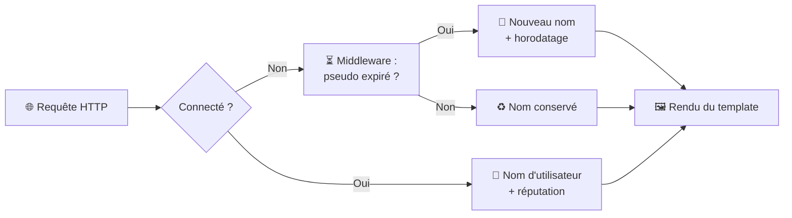

<div align="center">

# 🥋 Django Dojo — Sessions, Authentification & Permissions

### *Ou comment devenir ceinture noire des permissions et de la gestion d'utilisateurs*


**💡 Life Pro Tips** : application web de partage d'astuces avec système de votes,
gestion fine des permissions et privilèges attribués automatiquement selon la réputation.

```
   ⬜ → 🟨 → 🟧 → 🟩 → 🟦 → 🟫 → ⬛
  ex00  ex01  ex02  ex03  ex04  ex05  ex06
```

</div>

---

## 📜 Sommaire

1. [🎯 Présentation](#-1-présentation)
2. [🥋 Le parcours du disciple](#-2-le-parcours-du-disciple)
3. [🧠 Compétences mises en œuvre](#-3-compétences-mises-en-œuvre)
4. [📏 Règles métier](#-4-règles-métier)
5. [⚙️ Choix d'implémentation](#️-5-choix-dimplémentation)
6. [🏗️ Architecture](#️-6-architecture)
7. [🚀 Installation](#-7-installation)
8. [🧪 Procédures de test](#-8-procédures-de-test)
9. [✅ Checklist d'évaluation](#-9-checklist-dévaluation)

---

## 🎯 1. Présentation

Le projet est construit **pas à pas** : chaque exercice enrichit la même application Django, depuis une simple session anonyme jusqu'à un système de privilèges entièrement piloté par la réputation des utilisateurs.

L'objectif est de maîtriser les mécanismes natifs de Django en matière de **sessions**, d'**authentification** et de **contrôle d'accès**, avec un principe directeur :

> 🛡️ **Ne jamais faire confiance au client.** Cacher un bouton, c'est de la politesse ; vérifier la permission dans la vue, c'est de la sécurité.

### 👥 Qui peut faire quoi ? (état final)

| Profil | 👀 Lire | ✍️ Créer | 👍 Upvote | 👎 Downvote | 🗑️ Supprimer |
|:---|:---:|:---:|:---:|:---:|:---:|
| 👻 **Visiteur anonyme** | ✅ | ❌ | ❌ | ❌ | ❌ |
| 🙋 **Membre connecté** | ✅ | ✅ | ✅ | ses tips | ses tips |
| ⭐ **Réputation ≥ 15** | ✅ | ✅ | ✅ | ✅ | ses tips |
| 👑 **Réputation ≥ 30** | ✅ | ✅ | ✅ | ✅ | ✅ |

> 🏆 Ici, le pouvoir ne se donne pas : **il se gagne**.

---

## 🥋 2. Le parcours du disciple

| Ceinture | Exercice | Objectif | Points clés |
|:---:|:---|:---|:---|
| ⬜<br>**Blanche** | **ex00**<br>Sessions anonymes | Donner une identité temporaire aux visiteurs | Nom tiré parmi 10 valeurs de `settings.py`, durée de vie de **42 s**, affiché dès la première requête |
| 🟨<br>**Jaune** | **ex01**<br>Création d'utilisateurs | Inscription, connexion, déconnexion | Validation des formulaires, messages d'erreur, saisies conservées (hors mots de passe 🔒), redirections |
| 🟧<br>**Orange** | **ex02**<br>Nos Tips ! | Modèle principal et création | Modèle `Tip` (contenu, auteur, date), `ModelForm` réservé aux membres connectés |
| 🟩<br>**Verte** | **ex03**<br>Votes | Upvote, downvote, suppression | Votes exclusifs et annulables, cohérence garantie par `ManyToManyField` |
| 🟦<br>**Bleue** | **ex04**<br>Première permission | Restreindre la suppression | Permission native `delete_tip`, gestion via l'**admin Django** |
| 🟫<br>**Marron** | **ex05**<br>Permission personnalisée | Restreindre le downvote | Permission maison déclarée dans `Meta.permissions` |
| ⬛<br>**Noire** | **ex06**<br>Automatisation & réputation | Automatiser les privilèges | **User model personnalisé**, droits dérivés de la réputation, affichage `nom (réputation)` |

---

## 🧠 3. Compétences mises en œuvre

| Domaine | Notions Django | ex |
|:---|:---|:---:|
| 🍪 **Sessions** | `request.session`, expiration, middleware | 00 |
| 🔐 **Authentification** | `authenticate`, `login`, `logout`, hachage des mots de passe | 01 |
| 📝 **Formulaires et validation** | `Form`, `ModelForm`, `clean()`, `clean_<champ>()`, `PasswordInput` | 01 – 02 |
| 🗃️ **Modélisation des données** | `ForeignKey`, `ManyToManyField`, `related_name`, `auto_now_add` | 02 – 03 |
| ⚖️ **Intégrité de la logique métier** | Exclusivité des votes, annulation, aucun compteur désynchronisé | 03 |
| 🛡️ **Sécurité applicative** | Contrôle d'accès dans les vues, requêtes `POST`, CSRF, `@login_required` | 03 – 05 |
| 🎫 **Système de permissions** | `has_perm`, permissions par défaut et personnalisées | 04 – 05 |
| 🛠️ **Administration** | `admin.site.register`, superutilisateur, attribution des permissions | 04 |
| 👤 **Modèle utilisateur personnalisé** | `AbstractUser`, `AUTH_USER_MODEL`, `get_user_model()` | 06 |
| 🤖 **Permissions dynamiques** | Surcharge de `has_perm`, valeurs calculées | 06 |
| 📡 **Signaux** | Réaction aux événements du cycle de vie des modèles | 06 |
| 🎨 **Présentation** | Héritage de templates, fichiers statiques, Bootstrap | tous |

---

## 📏 4. Règles métier

### ⏳ Session anonyme
- Un nom est attribué aléatoirement parmi **10 noms** définis dans `settings.py`.
- Il reste identique pendant **42 secondes**, puis il est réattribué selon la même règle.
- Il apparaît **immédiatement**, sans rechargement supplémentaire.

### 👍 Votes
- Un tip fraîchement créé possède **0 upvote et 0 downvote**.
- Un utilisateur ne vote qu'**une seule fois** par tip, dans **un seul sens**.
- Recliquer sur le même bouton **annule** le vote.
- Voter dans le sens opposé **bascule** le vote.

### 🎫 Permissions
- 🗑️ Suppression : permission `delete_tip` requise, **sauf pour l'auteur**.
- 👎 Downvote : permission personnalisée requise, **sauf pour l'auteur**.

### ⭐ Réputation

| Événement | Effet |
|:---|:---:|
| 👍 Upvote reçu sur un de ses tips | **+5** |
| 👎 Downvote reçu sur un de ses tips | **−2** |
| 🗑️ Suppression d'un tip | effets de ses votes annulés |

| Seuil | Privilège débloqué |
|:---:|:---|
| **15** | 👎 Downvoter les tips des autres |
| **30** | 🗑️ Supprimer les tips des autres |

> ⚠️ Les privilèges sont **révocables** : une baisse de réputation sous un seuil retire le droit correspondant.

---

## ⚙️ 5. Choix d'implémentation

| Problème | Solution retenue | Pourquoi |
|:---|:---|:---|
| Afficher le pseudo anonyme dès la première requête | Middleware exécuté avant la vue | Le nom est créé ou renouvelé avant le rendu du template |
| Garantir la cohérence des votes | `ManyToManyField` plutôt que des compteurs | Le nombre de votes est toujours dérivé des données réelles |
| Restreindre les actions sensibles | Vérification des permissions dans les vues | Masquer un bouton ne protège pas une URL appelée directement |
| Aucune permission native pour le downvote | Permission déclarée dans `Meta.permissions` du modèle `Tip` | Évite de détourner une permission inadaptée |
| Anticiper le remplacement du modèle utilisateur | `settings.AUTH_USER_MODEL` et `get_user_model()` | Aucun appel en dur au `User` par défaut |
| Lier privilèges et réputation | Surcharge de `has_perm` dans le modèle utilisateur | Les droits suivent automatiquement la réputation |
| Annuler l'effet d'un tip supprimé | Réputation calculée à partir des tips existants | Un tip supprimé sort naturellement du calcul |

---

## 🏗️ 6. Architecture

```
d6/
├── 🛠️  Makefile
├── 📄 manage.py
├── ⚙️  d6/                        # Configuration du projet
│   ├── settings.py               # Liste des noms anonymes, AUTH_USER_MODEL
│   ├── urls.py
│   ├── asgi.py
│   └── wsgi.py
└── 💡 ex/                         # Application principale
    ├── models.py                 # User, Tip, votes M2M, permissions
    ├── forms.py                  # Inscription, connexion, ModelForm du Tip
    ├── views.py                  # Accueil, authentification, votes, suppression
    ├── middleware.py             # Gestion du pseudo anonyme ⏳
    ├── signals.py                # Signaux liés aux modèles
    ├── admin.py                  # Enregistrement dans l'administration
    ├── apps.py
    ├── urls.py
    ├── tests.py
    ├── migrations/
    │   └── 0001_initial.py
    ├── static/
    │   └── css/
    │       └── list_tips.css     # 🎨 Style de la liste des tips
    └── templates/
        ├── auth_base.html        # Template de base (<nav> commune)
        ├── welcome.html          # Page d'accueil
        ├── list_tips.html        # Liste des tips et actions
        ├── create_tip.html       # Formulaire de création
        ├── signup.html           # Inscription
        ├── login.html            # Connexion
        └── logout.html           # Déconnexion
```

### 🔄 Traitement d'une requête



### 🗃️ Modèle de données

```mermaid
erDiagram
    USER ||--o{ TIP : "écrit"
    USER }o--o{ TIP : "upvote"
    USER }o--o{ TIP : "downvote"
    USER {
        string username
        string password
        int reputation "calculée"
    }
    TIP {
        text content
        datetime date
        fk author
        m2m upvotes
        m2m downvotes
    }
```

---

## 🚀 7. Installation

**Prérequis :** Python 3, `pip`, version LTS de Django.

```bash
# 1️⃣  Récupérer le projet
git clone <url-du-depot> && cd <depot>/d6

# 2️⃣  Créer et activer l'environnement virtuel
python3 -m venv venv
source venv/bin/activate

# 3️⃣  Installer les dépendances
pip install -r requirements.txt

# 4️⃣  Initialiser la base de données
python manage.py makemigrations
python manage.py migrate

# 5️⃣  Créer un superutilisateur (nécessaire pour l'ex04)
python manage.py createsuperuser

# 6️⃣  Ouvrir le dojo 🥋
python manage.py runserver
```

| Ressource | URL |
|:---|:---|
| 🌍 Application | <http://127.0.0.1:8000/> |
| 🛠️ Administration | <http://127.0.0.1:8000/admin/> |

---

## 🧪 8. Procédures de test

<details>
<summary><b>⏳ ex00 — Sessions anonymes</b></summary>

1. Ouvrir la page d'accueil : `Hello <nom> !` s'affiche dans la `<nav>`.
2. Recharger plusieurs fois avant 42 secondes : le nom reste identique.
3. Attendre 42 secondes puis recharger : un nouveau nom s'affiche **immédiatement**.

</details>

<details>
<summary><b>🔐 ex01 — Authentification</b></summary>

| Scénario | Résultat attendu |
|:---|:---|
| Champs vides | ❌ Message « champ requis » |
| Nom d'utilisateur existant | ❌ Message d'erreur dédié |
| Mots de passe différents | ❌ Message d'erreur dédié |
| Identifiants incorrects | ❌ Message d'erreur, nom d'utilisateur conservé |
| Accès à `/signup` ou `/login` une fois connecté | ↩️ Redirection vers l'accueil |
| Déconnexion | ↩️ Retour à l'accueil avec un pseudo anonyme |

</details>

<details>
<summary><b>💡 ex02 — Tips</b></summary>

1. Non connecté : la liste est visible, le formulaire est absent.
2. Connecté : création d'un tip, affiché avec son contenu, son auteur et sa date.

</details>

<details>
<summary><b>👍 ex03 — Votes</b></summary>

| Action | 👍 | 👎 |
|:---|:---:|:---:|
| Création du tip | 0 | 0 |
| Upvote | 1 | 0 |
| Upvote à nouveau | 0 | 0 |
| Upvote puis downvote | 0 | 1 |

</details>

<details>
<summary><b>🎫 ex04 / ex05 — Permissions</b></summary>

1. Créer deux utilisateurs **A** et **B**.
2. **A** publie un tip : **B** ne peut ni le supprimer ni le downvoter.
3. Via `/admin`, attribuer à **B** la permission de suppression, puis celle de downvote.
4. **B** peut désormais effectuer ces actions ✅
5. Sans permission, un appel direct à l'URL de l'action est refusé 🚫
6. **A** peut toujours supprimer et downvoter son propre tip.

</details>

<details>
<summary><b>⭐ ex06 — Réputation</b></summary>

| Réputation | 👎 Downvote (autres) | 🗑️ Suppression (autres) |
|:---:|:---:|:---:|
| 0 – 14 | ❌ | ❌ |
| 15 – 29 | ✅ | ❌ |
| ≥ 30 | ✅ | ✅ |

- 3 upvotes reçus = 15 points → 👎 débloqué
- 6 upvotes reçus = 30 points → 🗑️ débloqué
- Supprimer un tip ayant rapporté des points fait baisser la réputation de son auteur, qui peut perdre ses privilèges.

</details>

---

## ✅ 9. Checklist d'évaluation

- [ ] 🐍 Python 3, Django LTS, `requirements.txt` présent et à jour
- [ ] ⏳ Pseudo aléatoire parmi 10 noms de `settings.py`, valable 42 s, affiché sans double rechargement
- [ ] 🧭 Nom du site au début de la `<nav>`, avec lien vers l'accueil
- [ ] 📝 Inscription : 3 champs, unicité du nom, mots de passe identiques, erreurs explicites
- [ ] 🔑 Connexion : 2 champs, erreurs explicites, saisies conservées (hors mots de passe)
- [ ] 🔒 Mots de passe masqués lors de la saisie
- [ ] 🚪 Déconnexion fonctionnelle, pages d'inscription et de connexion inaccessibles une fois connecté
- [ ] 💡 Tips listés avec contenu, auteur et date, création via `ModelForm`
- [ ] 👍 Votes exclusifs, annulables et cohérents, 0/0 à la création
- [ ] 🛡️ Suppression protégée par `delete_tip` côté serveur (exception : l'auteur)
- [ ] 🎫 Downvote protégé par une permission personnalisée côté serveur (exception : l'auteur)
- [ ] 👤 Modèle utilisateur personnalisé, réputation affichée sous la forme `nom (réputation)`
- [ ] 🤖 Seuils de 15 et 30 appliqués et révocables automatiquement

---

<div align="center">

### 🥋 *« Sapience n'entre point en âme malivole. »*
*— Traité de l'art juste de fabriquer des adresses hypées*

Projet réalisé dans le cadre de la Piscine Python‑Django

**⬛ Ceinture noire obtenue.**

</div>
