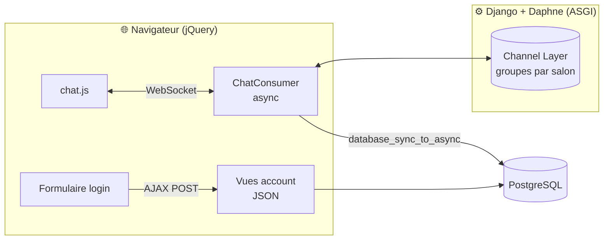
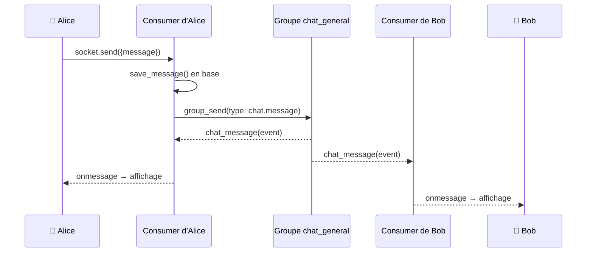

<div align="center">

# 💬 d09 — Chat temps réel avec Django

**Authentification 100 % AJAX · Chatrooms en WebSocket · Historique · Présence en direct**

<br>


<br>

*Projet final de la Piscine Python-Django — 42*

[Fonctionnalités](#-fonctionnalités) ·
[Architecture](#-architecture) ·
[Installation](#-installation) ·
[Compétences](#-compétences-mises-en-œuvre) ·
[Défis techniques](#-défis-techniques-relevés)

</div>

---

## ✨ En bref

Une application de messagerie instantanée construite **sans framework front-end** : seulement Django côté serveur, jQuery côté client, et une communication **exclusivement asynchrone** (AJAX pour l’authentification, WebSockets pour le chat).

Aucun rechargement de page, des messages diffusés en temps réel à tous les participants, et une liste des utilisateurs connectés qui se met à jour toute seule.

---

## 🚀 Fonctionnalités

| | Module | Ce qu’il fait |
|:-:|---|---|
| 🔐 | **Authentification AJAX** | Connexion et déconnexion en `POST` via AJAX, erreurs du formulaire affichées en direct, état conservé au rafraîchissement — sans jamais recharger la page. |
| 💬 | **Chatrooms** | Trois salons stockés en base, accessibles uniquement aux utilisateurs connectés, messages diffusés instantanément à tous les membres d’un même salon. |
| 📜 | **Historique** | À l’arrivée dans un salon, les trois derniers messages s’affichent dans l’ordre chronologique. |
| 🟢 | **Présence en direct** | Liste des utilisateurs connectés mise à jour en temps réel ; messages système `has joined` / `has left the chat` pour tout le salon. |
| 📐 | **Scroll intelligent** | Conteneur de taille fixe, défilement automatique vers le dernier message. |
| 🌗 | **Thème clair / sombre** | Interface responsive qui suit automatiquement la préférence du système. |

---

## 🏗 Architecture



### Le trajet d’un message



Chaque connexion WebSocket possède sa propre instance de `ChatConsumer`. Un message est déposé une seule fois dans le **channel layer**, qui le redistribue à tous les consumers du salon ; chacun le transmet ensuite à son navigateur. Le champ `type` de l’événement (`chat.message`, `users.update`) détermine la méthode appelée, ce qui permet de faire transiter plusieurs sortes de messages sur la même connexion.

---

## 📦 Installation

### Prérequis

- Python 3.10+
- PostgreSQL 14+
- `make`

### Démarrage rapide

```bash
git clone <url-du-depot>
cd d09

python3 -m venv django_venv
source django_venv/bin/activate
pip install -r requirement.txt

make        # démarre PostgreSQL, crée l’utilisateur et la base, applique les migrations, lance le serveur
```

L’application est ensuite disponible sur **http://127.0.0.1:8000**.

### Commandes utiles

| Commande | Effet |
|---|---|
| `make` | Initialisation complète (base de données, migrations) puis lancement |
| `make run` | Lance uniquement le serveur de développement ASGI |
| `make test` | Exécute la suite de tests |

<details>
<summary><b>🔧 Configuration</b></summary>

<br>

Les variables d’environnement sont chargées dans `settings.DATA_ENV`, notamment :

| Variable | Rôle |
|---|---|
| `SYSTEM_USERNAME` | Compte utilisé comme auteur des messages système (*joined* / *left*) |

L’utilisateur PostgreSQL du projet a besoin du droit `CREATEDB` pour que Django puisse créer la base de test :

```bash
sudo -iu postgres psql -c "ALTER USER djangouser CREATEDB;"
```

</details>

---

## 🗂 Structure du projet

```
d09/
├── d09/                 # Configuration : settings, urls, asgi
├── account/             # Authentification AJAX
│   ├── views.py         # Login / logout en JSON
│   └── templates/
├── chat/                # Messagerie temps réel
│   ├── models.py        # ChatRoom, ChatMessage
│   ├── consumers.py     # ChatConsumer (WebSocket, async)
│   ├── routing.py       # Routes WebSocket
│   ├── views.py         # Liste des salons, page de chat
│   └── templates/
├── static/js/
│   └── chat.js          # Client WebSocket (jQuery)
├── Makefile
└── requirement.txt
```

---

## 🧠 Compétences mises en œuvre

<table>
<tr>
<td width="50%" valign="top">

### ⚡ Temps réel & asynchrone
- Consumers **Django Channels** asynchrones
- Diffusion par **groupes** via le channel layer
- Routage d’événements typés (`chat.message`, `users.update`)
- Pont sync/async avec `database_sync_to_async`
- Serveur **ASGI** avec Daphne

</td>
<td width="50%" valign="top">

### 🗄 Base de données & ORM
- Modélisation relationnelle (`ForeignKey`, `ManyToMany`)
- Requêtes optimisées : `select_related` contre le problème **N+1**
- Extraction ciblée avec `values_list(flat=True)`
- **PostgreSQL** provisionné automatiquement par le Makefile

</td>
</tr>
<tr>
<td width="50%" valign="top">

### 🌐 Front-end sans framework
- Interface dynamique en **jQuery** uniquement
- Communication **AJAX** (POST + CSRF) et **WebSocket**
- Passage sécurisé du contexte Django au JS avec `json_script`
- CSS moderne : variables, flexbox, responsive, mode sombre

</td>
<td width="50%" valign="top">

### 🛡 Sécurité & qualité
- Accès aux salons réservé aux utilisateurs authentifiés
- Protection **XSS** : contenu utilisateur inséré via `.text()`
- Validation des messages entrants (vides, clés manquantes)
- Gestion propre des connexions refusées ou des salons inexistants
- Suite de **tests** Django sur base PostgreSQL dédiée

</td>
</tr>
</table>

---

## 🧩 Défis techniques relevés

<details>
<summary><b>Appeler l’ORM depuis un consumer asynchrone</b></summary>

<br>

L’ORM de Django est synchrone : l’appeler directement dans un `async def` lève `SynchronousOnlyOperation`, car une requête SQL bloquerait toute la boucle d’événements. Les accès à la base sont donc isolés dans des méthodes décorées par `@database_sync_to_async`, exécutées dans un thread séparé, et les QuerySets y sont évalués (`list(...)`, `.first()`) avant d’être renvoyés au code async.

</details>

<details>
<summary><b>Mettre à jour la liste des connectés chez tout le monde</b></summary>

<br>

Un simple `self.send()` n’atteint que le navigateur de la connexion courante. La liste est donc diffusée au **groupe** du salon via un événement `users.update`, géré par une méthode dédiée `users_update` sur chaque consumer. Côté client, un champ `type` dans le JSON permet à `onmessage` de distinguer un message de chat d’une mise à jour de présence.

</details>

<details>
<summary><b>Gérer proprement la déconnexion</b></summary>

<br>

Au moment où `disconnect()` s’exécute, le socket est déjà fermé : toute écriture dessus échoue. L’ordre des opérations est donc : retirer l’utilisateur du salon en base, **quitter le groupe**, puis seulement prévenir les autres membres (liste mise à jour et message *has left the chat*).

</details>

<details>
<summary><b>Afficher l’historique sans requêtes en cascade</b></summary>

<br>

Les trois derniers messages sont récupérés par ordre décroissant, découpés en SQL (`LIMIT`), puis remis dans l’ordre chronologique. `select_related('author')` charge les auteurs dans la même requête, ce qui évite une requête supplémentaire par message affiché.

</details>

---

<div align="center">

Réalisé par **jguaglio** dans le cadre de la formation Python-Django · 42

</div>
